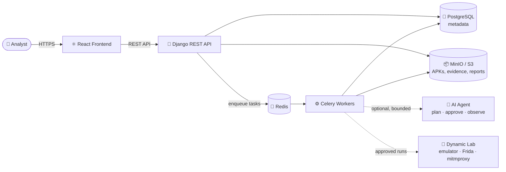
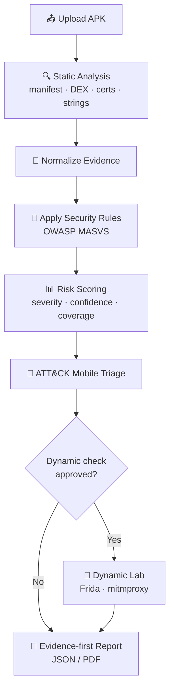

<div align="center">

# 🛡️ DroidSentry

### Mobile Security Assessment & Triage Platform
*Securing what connects you — one APK at a time.*


</div>

---

## 💡 Why I built this

As a cybersecurity engineering student, I wanted to go beyond running existing tools and
**build my own end-to-end mobile security pipeline** — from APK upload, to automated static
analysis, to analyst-ready reports. **DroidSentry** is my take on a modern, cloud-native Android
assessment platform: deterministic, explainable, evidence-first, and careful about where AI is
(and isn't) allowed to act.

---

## 🏗️ Architecture

Cloud-native by design: a stateless web tier, async workers, and clean separation between
metadata (PostgreSQL) and binary objects (MinIO/S3).



> 📌 A static architecture diagram is also available in [`docs/archi.png`](docs/archi.png).

---

## 🔄 Assessment Workflow

How an APK travels through the platform, from upload to report:



> ⚠️ DroidSentry **supports analysis — it does not guarantee a malware/benign verdict.**
> Findings are decision support for a qualified analyst, on applications you are authorized to test.

---

## ✨ Key Features

- 🔍 **Static analysis** — manifest, DEX, resources, strings, certificates, optional JADX source indexing
- 📐 **Explainable scoring** — severity, confidence, MASVS coverage and audit scores
- 🧩 **Rules engine** — versioned YAML catalogs (MASVS + ATT&CK-oriented)
- 📱 **Dynamic lab** — rootable emulator with ADB, Frida, mitmproxy, runtime CA overlay
- 🤖 **Bounded AI agent** — plan → approve → execute → observe, with hard budgets and redaction;
  the model never gets direct ADB, shell, filesystem, Docker, DB or storage access
- 🔐 **Secure by design** — session auth, CSRF protection, role-based access control

---

## 🧰 Tech Stack

| Layer | Technologies |
| --- | --- |
| **Backend** | Python · Django REST Framework · Celery · Redis · PostgreSQL · MinIO |
| **Frontend** | React · TypeScript · Vite |
| **Security** | Frida · mitmproxy · ADB · JADX · OWASP MASVS · MITRE ATT&CK Mobile |
| **Infra** | Docker · Compose · Kubernetes · Helm · GitLab CI/CD |

---

## 🗺️ Build Roadmap

This project is published incrementally, module by module:

- [x] 📄 Project setup & documentation
- [x] 🐍 Backend core (Django REST API + session auth)
- [ ] 🗂️ Projects, audits & object storage
- [ ] 🔍 Static APK analyzers
- [ ] 📐 Security rules engine (MASVS / ATT&CK)
- [ ] 🧩 Findings, indicators & evidence
- [ ] 📊 Risk scoring & reporting
- [ ] 📱 Dynamic analysis lab & AI agent
- [ ] ⚛️ Frontend (React + TypeScript)
- [ ] 🐳 Infra: Docker, Helm & CI/CD
- [ ] 🧪 Tests & samples

---

## 🚀 Quick Start (local demo)

```bash
cp .env.compose.example .env
docker compose up --build
# Frontend : http://localhost:5173
# API      : http://localhost:8000
```

Full walkthrough in [`docs/20_MVP_Demo_Runbook.md`](docs/20_MVP_Demo_Runbook.md).

---

## 📂 Structure

```
DroidSentry/
├── backend/        # Django REST API, Celery workers, 16 domain apps
├── frontend/       # React + TypeScript analyst interface
├── agent_runtime/  # Bounded agentic assessment harness
├── rules/          # Versioned YAML rule catalogs (MASVS / ATT&CK)
├── helm/           # Kubernetes Helm chart
├── docs/           # Architecture, API, security & deployment docs
└── tests/          # Integration tests & sample fixtures
```

---

## 🚀 More of my work

Want to see what I actually build and break? All my cybersecurity projects live on my GitHub —
offensive security labs, AI security, threat intelligence and IAM:

- 🔸 **prompt-injection-lab** — Attacking & defending an LLM agent against prompt injection
- 🔸 **ThreatLens** — Open-source Cyber Threat Intelligence (CTI) platform
- 🔸 **keycloak-iam-project** — Identity & Access Management with Keycloak
- 🔸 **SOC Assistant** — RAG + MITRE ATT&CK (Red Team & Evaluator)
- 🔸 **CyberResilience SME** — AI-driven cyber resilience recommendations

👉 → [github.com/aziz-benihya](https://github.com/aziz-benihya)

---

## ⚖️ Authorized Use

DroidSentry is an academic and institutional cybersecurity assessment platform. Use it only on
applications you are **explicitly authorized** to test. Dynamic instrumentation can alter app
behavior — keep the lab isolated and have an analyst validate every conclusion.

---

## 👤 Author

**Abdelaziz AIT BEN IHYA**
Cybersecurity & IT Engineering Student @ ENSA Agadir 🇲🇦
Interests: Offensive Security · Mobile Security · GRC · AI Security

🔗 [GitHub](https://github.com/aziz-benihya) · [LinkedIn](https://www.linkedin.com/)

<div align="center">
<sub>⭐ If you find this project interesting, feel free to star it!</sub>
</div>
